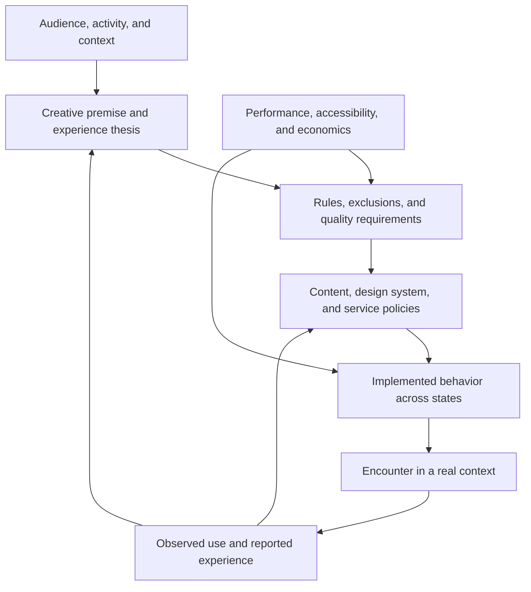

# Worldful Software Design
## Principles, patterns, and practices for coherent digital experiences

**Version:** 1.2 · **Research date:** 31 October 2026 · **Status:** completed reference edition  
**Terminology:** Worldful software is a provisional working concept proposed in this book, not an established academic discipline or a validated product category.  
**Basis:** the complete uploaded `Pasted text(1).txt` brief, recovered from the referenced conversation.

## Contents

1. [Purpose and reading routes](#1-purpose-and-reading-routes)
2. [Definition and boundaries](#2-definition-and-boundaries)
3. [Theoretical foundations](#3-theoretical-foundations)
4. [How coherence emerges](#4-how-coherence-emerges)
5. [Twelve design principles](#5-twelve-design-principles)
6. [Design and engineering systems](#6-design-and-engineering-systems)
7. [Case study: grug](#7-case-study-grug)
8. [Case study: Poolsuite FM](#8-case-study-poolsuite-fm)
9. [Comparative lessons](#9-comparative-lessons)
10. [Development methodology](#10-development-methodology)
11. [Evaluation and weighted rubric](#11-evaluation-and-weighted-rubric)
12. [Development checklists](#12-development-checklists)
13. [Anti-patterns and trade-offs](#13-anti-patterns-and-trade-offs)
14. [Reusable templates](#14-reusable-templates)
15. [Glossary](#15-glossary)
16. [Bibliography and evidence register](#16-bibliography-and-evidence-register)
17. [Four editorial passes](#17-four-editorial-passes)

## 1. Purpose and reading routes

Some applications communicate an unmistakable point of view before their logo becomes visible. Their content, controls, language, rhythm, and limits seem to belong together. This book examines how that relationship can be designed and maintained. Its purpose is to help a developer make decisions, including decisions to remove an attractive idea that does not serve the experience.

Worldful design is useful when the manner of doing something is part of its value. A short encounter can feel companionable; an administrative task can feel reassuring; a curated service can feel like entering a particular place. The same methods can also expose excessive decoration. An expressive loading sequence that delays every visit may undermine the experience it was intended to create.

Read Chapters 2–5 to establish a conceptual foundation, Chapters 7–9 to examine evidence, and Chapters 10–14 while developing an application. The fictional **Parcel Room**, a parcel-tracking utility, supplies worked examples throughout. It is an illustrative design exercise, not a verified product or proposed business plan. No additional real app case studies are introduced from the categories excluded by the brief.

### Evidence conventions

**Fact** means a source documents the statement; it does not mean the author independently inspected implementation. **Report** means a creator or reviewer describes an experience. **Interpretation** means a reasoned explanation offered here. **Method** means an original recommendation. These categories matter: a creator describing delighted users does not establish an experimentally measured effect.

The research combines current official release metadata, all twelve current App Store screenshots across the two products, creator interviews, official announcements, direct browser inspection of Poolsuite, and the theoretical literature identified in the bibliography. The revised case studies use actual figures and describe specific visible components and tested state changes. Poolsuite was inspected in both a signed-in session and a separate guest session on 31 October 2026. Grug’s official website and screenshot set were examined directly; native interaction was subsequently examined through the user’s iPhone Mirroring session, with direct captures and a reversible drawing test.

The evidence labels remain important: a screenshot establishes the pictured layout, a browser interaction establishes the observed behavior, a release record establishes a published version, and an interpretation explains a proposed mechanism. They are complementary forms of evidence.
## 2. Definition and boundaries

**Worldful software is software whose useful activity is organized by a recognizable creative premise, expressed coherently through content, behavior, sensory form, and the surrounding service experience.**

The word *worldful* emphasizes that the interface suggests an internally intelligible whole. That whole may be a character, a place, a craft tradition, or a distinctive way of treating the user. It need not include a fictional map, a story, a mascot, nostalgia, music, or realistic textures.

This book retains the term because the alternatives each emphasize only part of the intended subject. Experience-centered design supplies the broader intellectual foundation. Emotional design concerns affect and meaning. Design coherence concerns agreement among decisions. Authorship concerns identifiable judgment. Worldful software combines these concerns into a narrower working lens for application design; it does not replace them.

### Necessary characteristics in this framework

1. **A creative premise:** a specific proposition that excludes some plausible design choices.
2. **Functional integration:** the premise changes how the useful activity is presented or performed.
3. **Cross-surface coherence:** important encounters sustain compatible expectations.
4. **Recognizable authorship:** the product expresses selection and judgment beyond a generic component library.

These characteristics describe worldfulness. **Functional integrity** determines whether the result deserves to be called good software. Keeping the distinction explicit prevents attractive but inaccessible products from receiving an unqualified endorsement.

A consistent corporate dashboard may be excellent without being strongly worldful. A themed dashboard with pirate illustrations remains superficial if the metaphor neither clarifies its activity nor shapes its behavior. Conversely, a restrained utility can be worldful if its language, workflow, and operational commitments consistently enact a particular attitude.

| Related concept | Established or working usage | Relationship and boundary |
|---|---|---|
| Experience-centered design | Established HCI approach | Treats lived experience and meaning as central; does not require a distinctive fictional or authored world. |
| Experiential design | Broad practitioner term | Often covers environments and services; too broad to identify this particular software quality. |
| Emotional design | Established design framework | Explains affective and reflective dimensions; positive emotion alone does not establish coherence. |
| Product personality | Research/practitioner vocabulary | Describes attributed character; personality can exist without consistent behavior. |
| Digital worldbuilding | Practitioner/creative vocabulary | Constructs implied context and rules; elaborate lore is optional here. |
| Diegetic interface | Borrowed narrative/interface concept | Controls belong to the represented world. Worldful software can retain conventional, non-diegetic controls. |
| Aesthetic integrity | Design/platform vocabulary | Appearance and behavior suit purpose; not synonymous with decorative richness. |
| Sensory congruence | Perception/design vocabulary | Signals across senses agree in meaning. This book does not claim a universal optimal sensory combination. |
| Interaction gestalt | HCI research concept | Concerns the holistic qualities of unfolding interaction, rather than isolated visual elements. |
| Opinionated software | Practitioner term | Makes strong defaults and exclusions; opinions can still be incoherent or hostile. |
| Playful interaction | Design approach | Invites exploration or amusement; playfulness is optional, not a quality requirement. |

Beautiful UI concerns visual judgment. Skeuomorphism borrows recognizable material forms. Branding distinguishes a source. Gamification adds game-related structures. Conventional usability work improves task performance. Each can contribute, but none alone meets the definition above.

## 3. Theoretical foundations

### 3.1 Emotional design: appearance, use, and reflection

Don Norman distinguishes visceral, behavioral, and reflective aspects of design: immediate impact, the experience of operation, and subsequent meaning or self-image. These are analytical perspectives, not a mandatory sequence of screens. [Norman, 2008](https://jnd.org/emotional-design-people-and-things/).

**Application proposed here:** inspect a parcel confirmation at all three levels. A warm illustration may make it approachable; a clear delivered timestamp makes it useful; a dependable history may leave the user feeling in control. The illustration cannot compensate for a false timestamp. This is why a screenshot is insufficient evidence of experiential quality.

### 3.2 Experience design: begin with the intended experience

Marc Hassenzahl’s *Experience Design* develops an experiential perspective on interactive products. Its model and discussion of experience provide a foundation for asking why an activity matters before selecting interface features. [Hassenzahl, 2010](https://link.springer.com/book/10.1007/978-3-031-02191-6).

**Application proposed here:** distinguish a task goal, such as checking delivery, from an experiential intention, such as reducing uncertainty without encouraging compulsive checking. A real-time refresh button might serve the first while harming the second if it implies that constant checking is necessary. This is a design hypothesis to test, not a claim that refreshing inherently causes anxiety.

### 3.3 Technology as lived experience

John McCarthy and Peter Wright place emotional, intellectual, and sensual experience within everyday life. Their approach treats people’s encounters with technology as relational and open to interpretation. It draws on pragmatist thought rather than reducing experience to task completion alone. [McCarthy and Wright, 2004](https://mitpress.mit.edu/9780262633550/technology-as-experience/).

**Application proposed here:** evaluate an app in a plausible setting. A playful sound may be welcome at home and embarrassing in a meeting. A notification may be helpful during a delivery window and intrusive after completion. The designed artifact is only one contributor to the resulting experience. Authorship means shaping conditions, not controlling a person’s feelings.

### 3.4 Interaction as a whole

Lim, Stolterman, Jung, and Donaldson’s interaction-gestalt research directs attention toward the formal, holistic qualities of interaction. [Lim et al., 2007](https://doi.org/10.1145/1314161.1314183).

**Application proposed here:** study what happens between states. Two interfaces can display the same parcel card while differing in interruption, continuity, reversibility, and timing. A card that jumps position during a tap communicates instability even when every static frame follows the design system.

### 3.5 Accessibility as a constraint on expression

WCAG 2.2 provides testable web accessibility criteria, including text alternatives, keyboard operation, contrast, and controls for relevant motion or audio. Animation from interactions is a Level AAA criterion; it should not be casually described as a universal AA requirement. Native apps also require platform-specific accessibility evaluation. [W3C, WCAG 2.2](https://www.w3.org/TR/WCAG22/).

**Application proposed here:** represent each meaningful state in a semantic model independent of its illustration. A drawn delivery stamp can have an accessible status label, and motion can become an immediate state change. Equivalent meaning matters more than identical sensory output.

### 3.6 What the foundations do not prove

The literature supports examining experience beyond efficiency. It does not validate “worldfulness” as a psychological construct, establish the weights in Chapter 11, or prove that custom typography increases retention. Those are separate claims requiring separate evidence. The framework below is a disciplined synthesis and a set of proposed working tools.

## 4. How coherence emerges

A linear model from premise to perception is useful but incomplete. Users reinterpret products, operating conditions change, and engineering constraints reveal weaknesses in the original premise.



**Creative premise** states the organizing idea. **Experience thesis** connects that idea to an audience, activity, and intended effect. **Experiential coherence** describes the degree to which encounters support compatible expectations. **Functional integrity** describes whether people can understand, operate, and trust the software.

Coherence can work through repeated confirmation. If the copy promises a calm delivery desk, the information hierarchy prioritizes the next relevant event, and notifications arrive only when action is useful, successive encounters support the same interpretation. A countdown promotion interrupts that pattern because it introduces urgency for an unrelated purpose.

Uniformity is not the objective. A serious failure deserves more direct language than a celebratory success. The relationship remains coherent when both express care. Repeating the same joke in an error, a refund flow, and a privacy notice confuses consistency with sameness.

### A practical decision chain

For each major choice, record:

> Observation → evidence → proposed mechanism → expected consequence → transferable rule → local implementation → disconfirming test.

The last step prevents a case study from becoming an aesthetic commandment. If a hand-drawn control reduces recognition without adding meaningful character, the local implementation has failed even if it resembles a celebrated app.

## 5. Twelve design principles

All principles are **methods proposed by this book**. Evidence identifies their intellectual or practical starting points; it does not establish universal causal laws.

### Direction and scope

#### P1. State an experience thesis that excludes alternatives

**Definition:** connect purpose, audience, premise, and intended experience in one falsifiable statement. **Rationale:** vague aspirations cannot settle disagreements. **Mechanism:** exclusions turn taste into reviewable decisions. **Evidence:** experience-first reasoning in [Hassenzahl](https://link.springer.com/book/10.1007/978-3-031-02191-6). **Implementation:** write the thesis before choosing a visual style; list three attractive features it would reject. **Example:** Parcel Room helps occasional recipients understand what happens next through a calm service-desk metaphor. **Counterexample:** “Make tracking delightful” accepts almost anything. **Trade-off:** an early thesis can become dogma; revise it when observation contradicts it. **Verification:** two reviewers independently use it to evaluate the same feature, then explain disagreements.

#### P2. Make expressive choices participate in the useful activity

**Definition:** character should shape reading, deciding, acting, or understanding. **Rationale:** decoration disconnected from activity is easy to discard. **Mechanism:** users encounter identity through repeated use. **Evidence:** grug’s creators describe extending their rendering system across the app in the [Apple interview](https://developer.apple.com/news/?id=ux44ymcr). **Implementation:** identify one signature interaction and its functional purpose. **Example:** a parcel receipt groups status, source, and timestamp as one inspectable record. **Counterexample:** a mascot blocks the tracking number. **Trade-off:** not every control needs expression. **Verification:** compare expressive and conventional prototypes while preserving task information.

#### P3. Use constraints to protect the core encounter

**Definition:** omit features whose experiential cost exceeds their useful contribution. **Rationale:** each addition creates states, choices, and maintenance. **Mechanism:** a smaller decision space can preserve a clear activity. **Evidence:** grug documents a limited daily encounter in its [listing](https://apps.apple.com/us/app/grug/id6751649802). **Implementation:** maintain a constraints register with reasons and reversal conditions. **Example:** reject a social leaderboard in Parcel Room. **Counterexample:** excluding export solely to keep the interface visually sparse. **Trade-off:** constraints can deny legitimate needs. **Verification:** record requests that the current scope fails, including who is excluded.

### Expression and behavior

#### P4. Build a grammar across visual form and language

**Definition:** reusable rules govern typography, hierarchy, illustration, and tone. **Rationale:** one-off flourishes drift. **Mechanism:** recurring relations make unfamiliar screens intelligible. **Evidence:** grug is a concrete example; see Chapter 7. **Implementation:** define semantic tokens and copy rules with exceptions. **Example:** Parcel Room uses stable status labels and warmer explanatory sentences. **Counterexample:** one screen says “Delivered” and another says “Treasure secured” for the same state. **Trade-off:** expressive vocabulary can conflict with translation. **Verification:** review all status terms together and test comprehension without decorative context.

#### P5. Give feedback a defined meaning

**Definition:** motion, sound, and haptics communicate an event or deliberate atmosphere. **Rationale:** unexplained feedback competes with the task. **Mechanism:** predictable correspondence helps users distinguish acceptance, progress, and failure. **Evidence:** interaction-gestalt research motivates evaluating temporal behavior; the particular rule is this book’s synthesis. **Implementation:** map each feedback pattern to a state transition and provide alternatives. **Example:** a brief confirmation follows a successful save, never a failed network request. **Counterexample:** confetti plays after every tap. **Trade-off:** ambient effects may be meaningful without conveying status, but should be optional. **Verification:** mute sound and disable motion; all essential outcomes must remain understandable.

#### P6. Let content carry the premise

**Definition:** selection, ordering, and editorial standards support the intended encounter. **Rationale:** attractive containers cannot repair contradictory content. **Mechanism:** content repeatedly supplies the substance of the world. **Evidence:** Poolsuite explicitly describes curated channels in its [listing](https://apps.apple.com/us/app/poolsuite-fm/id1514817810). **Implementation:** document inclusion and rejection examples. **Example:** Parcel Room presents verified delivery events before promotional carrier messages. **Counterexample:** a calm interface foregrounds irrelevant urgency. **Trade-off:** curation can narrow representation or discovery. **Verification:** audit a sample of ordinary, exceptional, and newly added content against the policy.

#### P7. Preserve meaning across the whole journey

**Definition:** onboarding, settings, errors, permissions, and exit belong to the design system. **Rationale:** peripheral states often contain the strongest contradictions. **Mechanism:** continuity survives when the product is under stress. **Evidence:** technology-as-experience motivates examining broader encounters; this operational test is proposed here. **Implementation:** design failure and recovery alongside the happy path. **Example:** a delayed delivery explains uncertainty plainly without abandoning a courteous voice. **Counterexample:** generic technical errors appear inside an otherwise carefully authored app. **Trade-off:** legal and platform text may need conventional wording. **Verification:** walk through denied permissions, empty data, expiry, cancellation, and recovery.

### Integrity and stewardship

#### P8. Keep functional integrity non-negotiable

**Definition:** expression must preserve comprehension, access, reliability, and user control. **Rationale:** expressive success cannot excuse blocked tasks. **Mechanism:** dependable behavior supports trust in the authored environment. **Evidence:** [WCAG](https://www.w3.org/TR/WCAG22/) supplies relevant web requirements. **Implementation:** set release gates before scoring expression. **Example:** every illustrated status has semantic text. **Counterexample:** drawing text into an inaccessible canvas without an equivalent representation. **Trade-off:** accessible alternatives may look different. **Verification:** test critical tasks using keyboard, assistive technology, text enlargement, and reduced motion as applicable.

#### P9. Make economics part of the experience thesis

**Definition:** payment, advertising, authentication, and data practices must support honest expectations. **Rationale:** business mechanisms alter the encounter. **Mechanism:** predictable obligations reduce surprises. **Evidence:** the cases illustrate different low-friction presentations, not a universal free-product business model. **Implementation:** storyboard purchase, cancellation, and refusal with the core task. **Example:** explain paid history retention before a person relies on it. **Counterexample:** hide a completion step behind an unannounced paywall. **Trade-off:** sustainable revenue may require visible boundaries. **Verification:** a new user can explain what is free, what costs money, and what happens after cancellation.

#### P10. Spend custom engineering where it changes the experience

**Definition:** customize only when the benefit survives comparison with simpler implementation. **Rationale:** bespoke systems create long-term obligations. **Mechanism:** selective investment protects signature behavior without multiplying fragility. **Evidence:** grug’s creator account documents a consequential rendering decision. **Implementation:** prototype with standard components, then isolate the remaining expressive gap. **Example:** custom receipt transitions around standard accessible buttons. **Counterexample:** replacing every platform control merely to avoid familiar visuals. **Trade-off:** platform components can constrain expression. **Verification:** evaluate maintenance, localization, accessibility, and performance alongside the prototype’s experiential gain.

#### P11. Preserve identity through adaptation

**Definition:** translate the premise to different devices and abilities rather than copying a screen literally. **Rationale:** contexts impose different requirements. **Mechanism:** semantic continuity can survive visual change. **Evidence:** Poolsuite lists CarPlay integration; that documents a surface, not its quality. **Implementation:** specify what each surface must communicate and what it may omit. **Example:** a widget shows the next event without recreating a full service desk. **Counterexample:** shrinking an entire desktop metaphor into an unreadable widget. **Trade-off:** some expressive detail disappears. **Verification:** compare the meaning and task outcome across surfaces, not pixel similarity.

#### P12. Treat coherence as a maintained property

**Definition:** reassess identity after releases, content changes, and operational failures. **Rationale:** a coherent launch can become an inconsistent service. **Mechanism:** regression review detects accumulated contradictions. **Evidence:** historical Poolsuite reviews illustrate why aesthetic enthusiasm and functional complaints must be considered together. **Implementation:** keep a small set of representative journeys and review them after consequential changes. **Example:** inspect new carrier integrations against existing status semantics. **Counterexample:** approving each feature independently without revisiting the whole journey. **Trade-off:** review adds work; sample according to risk. **Verification:** every significant addition records its contribution, conflict, and post-release evidence.

## 6. Design and engineering systems

### 6.1 Tokens express roles

Primitive values describe colors and dimensions; semantic tokens describe their jobs. The latter protect intent during theme changes. A token called `status.uncertain` is more useful than using a yellow value in unrelated places, because uncertainty can later receive text, icon, and contrast changes together.

```yaml
# Illustrative specification, not a library API or universal timing standard.
text:
  reading: platform-scalable-body
  accent: expressive-heading-with-fallback
color:
  surface: warm-neutral
  text: high-contrast-ink
  status-uncertain: tested-caution-pair
motion:
  confirmation: brief-local-change
  reduce-motion: immediate-state-update
feedback:
  save-success: visible-label-plus-optional-haptic
  save-failure: persistent-explanation-and-retry
copy:
  status: literal-and-stable
  support: warm-and-direct
```

Do not make every modality mandatory. A silent product can have strong sensory coherence. Icons should preserve consistent geometry and semantic distinctions. Illustrations can be irregular while layout alignment remains disciplined. Typography should separate expressive display work from long-form reading where necessary. Color should reinforce status rather than carry it alone.

### 6.2 Component contracts

A component contract includes more than default appearance. A parcel card needs loading, stale, empty, active, delivered, and failed states; an accessible name; reading order; text-expansion behavior; action semantics; and a policy for untrusted carrier text. Its drawing style must not determine its business state.

Keep three layers separate: domain state, accessible interaction semantics, and expressive presentation. A renderer may animate a delivered stamp, but the domain event must remain correct if animation is skipped. Repeated taps must not create duplicate actions. A screen-reader announcement should describe the result, not narrate every animation frame.

### 6.3 Timing and performance

Set project-specific budgets from representative hardware and tasks. For example, Parcel Room might require local status content to appear within one second in a cold-start test on its oldest supported device, with an immediate indication when a refresh starts. These are proposed targets, not research-derived thresholds.

Measure startup separately from remote freshness. Cache the last successful state with its timestamp; never disguise stale information as current. Test animation under load, interrupted requests, app suspension, and reconnection. A graceful empty state cannot substitute for correct data preservation.

### 6.4 Custom rendering decisions

A custom renderer is justified when a prototype demonstrates that ordinary text or controls cannot express an important repeated interaction, and the team can support the resulting obligations. Evaluate glyph coverage, language expansion, selection, accessibility semantics, scaling, caching, hit testing, and long-term platform compatibility.

Compare three options: standard rendering with expressive assets; a hybrid system; fully custom rendering. Choose the least complex option that preserves the demonstrated benefit. grug’s documented choice is evidence that deep customization can be central to a premise, not evidence that every app should build a font engine.

### 6.5 Operational and economic coherence

Authentication should appear when the task needs identity. Permissions should follow a comprehensible action. Notifications should communicate relevant change. Paid boundaries should be understandable before users invest effort. Privacy claims should reflect actual behavior rather than a reassuring illustration.

A free app still has costs: development time, maintenance, hosting, content rights, and opportunity cost. This book does not infer profitability from a free listing. A paid product can be coherent when its exchange is clear and its maintenance dependable. A fictional atmosphere never licenses fictional payment terms or misleading system status.

## 7. Case study: grug

**Case updated:** 31 October 2026. **Product:** grug, by Ocho. **Current published iPhone build:** 1.5.3, released 23 October 2026. This analysis uses all seven screenshots currently supplied through Apple’s US catalog, the live official website, current release metadata, and the dated creator interview. The figures include official product evidence and direct captures of the running iPhone app. Native inspection was added in version 1.2.

### 7.1 Product overview and functional purpose

Grug presents a short daily reflection and gives the reader space to draw a response. The screen is closer to a dated, partly unfinished sheet than a feed: a drawing region above, a reflection below, and a row of dated pictograms at the bottom. That arrangement matters. Reading is not buried under discovery, categories, or a dashboard; the product presents a small encounter that can end after one thought.

The current official site is **[grug.so](https://www.grug.so/)**, linked from [Ocho’s website](https://www.ocho.so/). The brief’s grug.io address belongs to a different product. The site itself participates in the identity: the download button is followed by a description of the phone as a “glowing rectangle,” while an award link describes Apple through the character’s vocabulary. This gives us a concrete example of the product’s voice continuing outside the native interface.

**Current release evidence:** Apple’s [lookup record](https://itunes.apple.com/lookup?id=6751649802&country=us) identifies version 1.5.3 and the release note “grug make ready for larger cave.” The wording continues the voice, but does not tell us what changed technically. It should not be interpreted as proof of a particular new screen size or platform.

### 7.2 Creative premise and intended emotional experience

The useful act is small, and the world is built around making smallness acceptable. Grug speaks with elementary words and incomplete grammar, draws with uneven lines, and leaves large parts of the page unfilled. These decisions reinforce a premise: one can begin with an imperfect contribution.

That premise is more specific than “a cute caveman.” A polished illustration of a caveman above conventional productivity controls would express a theme. Here, the apparent making of the interface is consistent with the action offered to the reader. A rough drawing belongs beside a rough drawing; participation does not require producing something that matches a professional illustration.

**Interpretation:** intentional visual imperfection can lower the apparent standard for participation. The product invites a mark, rather than a finished artwork. This is an explanation of the design, not a measured claim that every user feels less pressure.

### 7.3 Core experience model: read, mark, place in time

<figure>

<figcaption><strong>Figure G1.</strong> Current App Store screenshot 2. The blank region is an invitation to participate, not a missing-content state. Source: Ocho via Apple’s screenshot catalog, retrieved 31 October 2026.</figcaption>
</figure>

Read this screen from top to bottom:

1. A small product name and a filled circular mark establish a sparse upper edge.
2. An angled handwritten annotation—“you draw for grug”—points into the empty drawing area. The instruction looks like a note left on the page, rather than an onboarding modal.
3. The reflection sits low on the screen. It relates a first thought in the morning to planting a seed; the large empty region remains available above it.
4. The reflection ends with the character’s name and a date-like lesson marker. The presentation resembles an individually authored entry rather than an anonymous content card.
5. The bottom row offers miniature drawings with dates. The central share-like upward arrow receives a tall, irregular outline. At the right, a short stacked phrase indicates a return at sunrise.

This composition changes the implied unit of use. A quote-feed interface says “browse more items.” This page says “spend a moment with this one.” The dated icons still permit movement through entries; the point is not that navigation disappears, but that it remains subordinate to the current page.

**Practical transfer:** when designing a brief reflective utility, make the primary encounter visibly complete. Place optional history and sharing around it. Do not assume that a short content item needs an infinite scroll container.

### 7.4 Visual and linguistic design systems

#### The roughness is distributed

The screenshots show uneven handwriting in the reflections, dates, miniature labels, and even the depicted time and battery outline. The battery’s rectangular enclosure and the share control’s elongated enclosure are both visibly drawn. The app does not reserve imperfection for a mascot while its surrounding chrome looks machined.

The official screenshots establish the intended treatment; the native inspection described below additionally confirms drawn time and battery indicators in the running app.

The content drawings share several characteristics: thin contours; little or no filled shading; simple recognizable subjects; and large surrounding areas of flat color. A flower with roots, an arrow through a heart, a sign, and a smiling bag provide very different subjects while preserving one method of drawing. The system creates variety through subject matter rather than through a new illustration style for every lesson.

#### Color changes the atmosphere without changing the grammar

<figure>


<figcaption><strong>Figure G2.</strong> Three current promotional screenshots demonstrate coordinated colorways. The fixed layout, line treatment, and control hierarchy remain recognizable as the palette changes.</figcaption>
</figure>

The green example pairs a dark field with pale strokes. The mint example uses reddish drawing and text. The nearly black example uses warm orange strokes. The blue heart example supplies another distinct field. These are not merely backgrounds placed behind black controls: the drawing, text, and surrounding indicators participate in the colorway.

**Mechanism:** coordinated roles make customization compatible with authorship. The reader can encounter a different mood while retaining the same hierarchy and material. The lesson for a developer is to theme semantic roles together—page, ink, accent, selected state—rather than exposing unrelated color pickers.

#### A voice with rules

The language uses short clauses, simple physical comparisons, omitted articles, and the character’s name in place of a conventional first-person narrator. Text is left aligned with uneven handwritten forms rather than mechanically centered in motivational-poster fashion.

This matters because the product’s topic could otherwise invite grand authority. Small diction and rough marks make the speaker seem fallible and approachable. The “primitive” grammar also presents a trade-off: characterful English should not automatically be assumed easier for second-language readers, translators, or assistive-technology pronunciation.

A developer borrowing this approach should create a language rulebook with examples for ordinary use, errors, permissions, and consequential actions. The rulebook must say when clarity takes priority over the joke.

### 7.5 Interaction and sensory design: where the engineering changes the expression

**Creator-documented implementation:** in Apple’s 16 May 2026 interview, Jip van der Velde and Michel Elings describe building an in-app letter-drawing canvas with a live lesson preview, then a renderer using their stroke data. They chose to extend the system across layout, animation, sizing, icons, and interaction states. They also describe letters appearing as if written, rather than simply fading in. [Apple Developer interview](https://developer.apple.com/news/?id=ux44ymcr).

That is the important distinction between a font choice and an interaction system. A font can supply glyph shapes; stroke data can also supply a path through time. If the marks appear progressively, the visual material and the transition use the same underlying description.

**Interpretation:** writing-on animation implies an act of making. The message can seem to arrive from a character rather than a content database. The implementation therefore serves a repeated, central moment, rather than a one-off launch flourish.

This is also a precise engineering trade-off. When a team owns rendering, it must account for line breaking, scaling, layout measurement, repeated letters, hit areas, and accessible text. Drawing a legible letter once is only the beginning. A developer should test the longest real lesson, largest supported reading size, and alternative rendering before adopting the same architecture.

No haptic or UI-sound pattern is needed to explain this particular effect. The case’s strongest documented sensory relationship is between the visible stroke, the typography, and the temporal appearance of the words.

#### Native inspection: short lesson, expanded explanation, and reversible drawing

Direct inspection through iPhone Mirroring on 31 October 2026 adds several details that the promotional screenshots do not establish.

The main page includes a handwritten tap annotation above the daily text. Activating the text opens a separate reading view: a curved back arrow and the lesson date sit above a multi-paragraph explanation. The inspected 31 October entry expands its short reflection on jealousy into a story about learning from other people’s success. This is **progressive disclosure of depth**. The entry page supports a brief encounter; readers who want context can choose a longer one without making everyone read it first.

<figure>


<figcaption><strong>Figure G5.</strong> Main lesson and optional explanation, captured from the running iPhone app on 31 October 2026. The two views share a typographic material while supporting different reading depths.</figcaption>
</figure>

The drawn time and battery also appear in the running app. Across the inspection, the time changed while retaining the same lettering. This confirms the status treatment as part of the actual presentation, rather than only a marketing composition. It does not require every piece of physical hardware to disappear: the Dynamic Island remains a hardware/platform boundary, particularly visible against the light theme.

The previous-day controls are functional even when their pictograms appear as question marks. Selecting 30 October loaded that day’s lesson and shifted the dates around it; 31 October remained reachable through a flame pictogram. A question mark therefore cannot safely be interpreted as a locked or unavailable item. **Design implication:** an expressive marker’s meaning must be tested through behavior before assigning it a conventional status such as disabled, unread, or paywalled.

Drawing is available directly on the main page. A short test stroke appeared immediately, and an undo arrow appeared near the upper-right controls. Undo removed the stroke and revealed a redo arrow. This is a concrete example of **state-dependent disclosure**: editing controls emerge when there is an edit to reverse, allowing the empty page to remain sparse. The test stroke was undone; it is not part of the user’s original drawing.

<figure>


<figcaption><strong>Figure G6.</strong> Contextual drawing controls and the peripheral appearance/support surface. The small test stroke was removed through undo. The promotional panel is an actual observed part of the product.</figcaption>
</figure>

Sharing crosses a deliberate boundary. The large outlined share control opens the standard iOS share sheet, with system destinations and actions. Grug does not redraw the whole operating-system sharing interface. **Transferable lesson:** maintaining an authored world can include a clear handoff to a familiar platform service. The useful continuity is preserved purpose and recoverable navigation, not a requirement that every system surface imitate the app.

The native controls also qualify the claim about minimalism. The top-right circle opens a separate appearance/support surface containing symbolic appearance options, an outlined promotion for another Ocho game, a rating request, feedback, and studio attribution. Selecting the sun option produced a white main page with black text and controls; the dark page used the inverse treatment. The change reaches the lesson, annotations, dates, navigation, share outline, time, and battery, preserving the hierarchy across the color inversion.

**Implementation pattern:** model the current lesson, expanded-reading route, drawing history, and appearance separately. A lesson can have both a summary and a longer body; undo visibility follows the drawing history; theme changes should not reset either content or navigation. Verify these relationships with actual state transitions rather than only component screenshots.

### 7.6 Content and functional integration: the page accepts a reply

The official drawing invitation is placed inside the same surface as the reflection. There is no visible boundary between “authored illustration over here” and “your contribution in another tool.” The supplied app description confirms drawing as a feature; the screenshot shows how the invitation is integrated spatially.

A seed reflection shares a visual language with the flower-and-roots lesson. The heart illustration accompanies a lesson about safety and growing stronger. A smiling shopping bag accompanies a reflection on carrying what makes one stronger. The drawings are small conceptual counterparts to the text, not unrelated filler images.

The bottom pictograms also connect content and navigation. Previous entries are identified through tiny drawings and dates, making history resemble a row of remembered pages. This is a concrete instance of the premise reaching information architecture: navigation adopts the content’s material.

**Practical transfer:** use representations people already encounter in the content as recognition cues in navigation, provided labels and accessible names make the actions understandable. Do not require users to decode a pictogram solely because it belongs aesthetically.

### 7.7 Deliberate constraints and omitted features

The official site describes an account-free, cloud-free, tracking-free encounter. The screenshots concentrate on one lesson and its surrounding drawing space. These are positive design choices with costs: a local-first experience reduces prerequisites, but cloud-free operation cannot be presumed to offer cross-device continuity.

The screenshot’s sunrise message makes waiting part of the identity. A conventional content service might advertise how much remains to consume; grug makes the next daily arrival part of the character’s rhythm. This is a **visual and linguistic observation**, not a claim that every older entry is inaccessible or that the app enforces a particular retention schedule.

For a developer, a useful constraint register would contain “one main encounter at a time,” its intended benefit, the history access users still need, and the evidence that would justify changing the rule.

### 7.8 Business model and experiential friction

Grug is currently listed as free. Its official site makes absence of login and tracking part of the promise. Native inspection also found an optional cross-promotion for another Ocho game on the appearance/support surface. A low-friction daily encounter should therefore be distinguished from an absence of all promotional content. That combination makes the first useful encounter structurally simple: the product is not asking the person to establish an identity before receiving the thought.

The broader studio’s presentation gives this stance additional context. Ocho’s current site describes a two-designer practice making small, unusual applications, emphasizes the care in drawing and tiny interactions, and presents its Apple Design Award through the same playful voice. [Ocho](https://www.ocho.so/).

This does not establish a reproducible funding model for another developer. The transferable decision is to align the entry requirements with the smallness of the intended encounter. A product with ongoing server costs may make a different exchange while preserving equivalent clarity.

### 7.9 Concrete implementation and engineering implications

A practical architecture inspired by the observed system would separate four things:

| Layer | Responsibility | Failure to avoid |
|---|---|---|
| Semantic lesson | Text, date, content identity, accessible reading order | Treating strokes as the only surviving representation of words. |
| Expressive geometry | Letter paths, illustration strokes, icon shapes | Copying a drawing asset into unrelated screens with inconsistent scaling. |
| Interaction semantics | Select entry, share, draw, change appearance | Making a thin drawing stroke the entire touch target. |
| Presentation state | Colorway, stroke animation, reduced-motion alternative | Letting the theme change status meaning or letting animation govern data state. |

This is a proposed implementation pattern, not a claim about Ocho’s private code. It shows how to retain the expressive benefit without merging content storage and rendering into an unmaintainable object.

A particularly useful acceptance test is to replace all stroke rendering with ordinary text and accessible controls. If the same lesson, action state, and reading order survive, the semantic model is healthy. Then restore the expressive layer and evaluate what it contributes.

### 7.10 Evidence across the app, widgets, website, and updates

<figure>

<figcaption><strong>Figure G3.</strong> The widget examples use different amounts of content while retaining the app’s drawing and color grammar. System integration is a translation of the premise, rather than a miniature copy of the full screen.</figcaption>
</figure>

The large yellow widget foregrounds a sun and a sprout. Smaller green and blue widgets carry short reflections. Their difference is instructive: coherence does not require putting every component on every surface. The widget’s available area determines whether the drawing or the words should lead.

The website offers another translation. In the inspected dark presentation, a small app icon sits beside handwritten copy and a single bright download control. Social links and the date/theme control remain secondary. The current date appears beneath a moon symbol; the button’s accessible description explains light/dark switching. This is a specific example of an expressive visible surface retaining a more explicit accessible label.

<figure>

<figcaption><strong>Figure G4.</strong> The official website, captured 31 October 2026. The same voice and stroke character continue into acquisition, award communication, and theme controls.</figcaption>
</figure>

Current release notes preserve the voice. Earlier displayed entries include “grug hit bug with stick.” The language is recognizable, but offers little diagnostic information. For a small consumer app that may be acceptable; a product with consequential workflow changes would need clearer supporting notes.

### 7.11 Strengths, weaknesses, and trade-offs

The most convincing achievement is not that every detail is handmade. It is that the handwritten system supports three related activities: receiving a small thought, leaving a small mark, and recognizing that encounter elsewhere.

The strongest tensions are visible in the evidence itself:

- **Thin-stroke legibility:** a delicately drawn letter may be expressive at promotional scale and harder to read at small sizes.
- **Icon recognition:** dates help, but a flower or cave is not inherently a familiar navigation command.
- **Temporal cost:** writing-on animation may add presence on first use and impatience on repeated use.
- **Localization:** character grammar and a custom glyph set require adaptation, not mechanical translation.
- **Expressive release notes:** consistent voice can conceal the practical significance of an update.

These are concrete review targets. They are not assertions that the current app fails those tests.

### 7.12 Transferable principles, grounded in specific decisions

| Specific decision | Mechanism | Transferable practice | Test before adopting |
|---|---|---|---|
| An annotated blank drawing area above the lesson | Turns apparent emptiness into an invitation | Design an active empty state inside the activity | Can a new user explain what they may do without a tutorial? |
| Thin strokes across letters, status representation, and controls | Establishes a common material | Define shared geometry rules, not just a display font | Are touch targets and semantic labels independent of visible ink? |
| Dated content pictograms | Makes history feel like remembered pages | Reuse content motifs as recognition cues | Can users identify and navigate entries reliably? |
| Coordinated ink and background colorways | Allows variety within a stable grammar | Theme roles together | Does every colorway preserve hierarchy and contrast? |
| Drawing and text widgets | Adapts the premise to different space constraints | Choose the meaning each surface should prioritize | Does the smaller surface remain useful without opening the app? |
| Character voice on the official website and release notes | Extends authorship beyond primary screens | Maintain a cross-surface copy inventory | Is consequential information still explicit? |

### 7.13 What would be lost if the interface became conventional?

A conventional version could retain the daily text, history, sharing, and drawing. What it would lose is the repeated suggestion that the whole encounter was made by the same imperfect hand. A generic quote card would separate the reflection from the control system; a professional illustration would raise a different standard for the reader’s drawing.

That is the actionable interpretation of worldfulness here: the useful action and the apparent method of making belong together. The lesson is not to imitate grug’s grammar. It is to identify a material and behavior that make your own product’s invitation credible.

**Visual-source note:** Figures G1–G3 reproduce screenshots currently distributed by Ocho through Apple’s catalog. Their dates are lesson content, not app-version timestamps. All seven originals are retained with the accompanying source assets. Native interactions are identified separately from promotional stills. Physical haptics are not established through mirroring.

## 8. Case study: Poolsuite FM

**Case updated:** 31 October 2026. This chapter combines direct interaction with the current website, current App Store screenshots and release metadata, official announcements, and the 2019 creator interview. The website was inspected both in an existing signed-in session and in a separate guest session; the guest session was used to test entry to playback. Version 1.2 adds operation of the installed iPhone app in an existing signed-in session, including theme changes, TV behavior, profile presentation, mixtape playback, and the Newsroom handoff. Account identity is not reproduced in the figures.

### 8.1 Product overview and functional purpose

Poolsuite is currently more than a themed music player. The website presents music, video, mixtapes, editorial material, membership, events, and other destinations as applications inside a fictional desktop. Its player remains a central useful activity, but the surrounding world is now an organizing shell for an expanding leisure service.

The release chronology distinguishes a named design generation from published software build numbers:

| Evidence layer | Date or version | What it establishes |
|---|---|---|
| Original Poolside.FM website interview | 26 July 2019 | Historical motivation and design choices. |
| Official cross-platform V3 announcement | 4 June 2025 on the public article; 5 June in the inspected website’s localized list | V3 as a named redesign across web and mobile. |
| Current website About window | Displays Version 3.0 | The website’s own visible version label. |
| Current iOS catalog record | Build 2.6; released 1 October 2026 | App Store release version, distinct from the V3 experience name. |
| Current screenshot set | Five images retrieved 31 October 2026 | The promotional mobile presentation currently supplied by the developer. |

Sources: [official V3 announcement](https://palmreport.poolsuite.net/poolsuite-v3/), [Apple’s current catalog record](https://itunes.apple.com/lookup?id=1514817810&country=us), and the [live website](https://poolsuite.net/). The day difference between the article and the in-app list is retained as a display difference rather than silently standardized.

The current iOS release note refers to bug fixes and improvements to the account area and authentication. That is relevant evidence: accounts are part of the current product. The account and service surfaces belong in an analysis of the current design.

### 8.2 Creative premise and intended emotional experience

The historical motivation was a virtual summer escape, conceived against rainy Scottish surroundings. The 2019 interview also records the designer’s ambition to invent a plausible new historical operating system rather than reproduce one literally. [Lucy Bourton, 2019](https://www.itsnicethat.com/articles/poolside-fm-digital-260719).

The current website makes that premise concrete in a different, larger form. The top bar places the calendar in **1997** while retaining the actual day and month. Window title bars, a bottom application dock, pixel-like labels, media filenames, and inset control panels make listening feel like an activity on a particular machine.

**Interpretation:** the product is a leisure establishment expressed as a computer environment. A visitor is offered music, things to read, and places to explore, all chosen by an identifiable host. This is why “nostalgic” is an insufficient description. Nostalgia identifies a reference; it does not explain the selection, behavior, or contemporary service structure.

### 8.3 Core experience model: radio, channel, or mixtape

The inspected guest session opened the player on Poolsuite ON AIR in a stopped state. Starting it produced an intermediate tuning message, then a live state and track metadata. No account form interrupted that tested sequence.

The channel selector exposed **seven curated channels in addition to ON AIR**:

| Channel | Choice offered by the name and current mobile caption |
|---|---|
| Poolsuite FM | The default collection; the screenshot frames it as the classics. |
| Friday Nite Heat / Friday Night Heat | An upbeat evening direction; spelling differs between screenshot and website. |
| Balearic Sundown | A sunlit, end-of-day framing. |
| Latest 20 Tracks | Recency as an explicit alternative to a mood. |
| Indie Summer | A breezier genre-oriented framing. |
| Hangover Club | A recovery or slower-day context. |
| Tokyo Disco | A city-and-genre image rather than a technical filter. |

These names do different editorial jobs. Some describe a social occasion, some a musical direction, and one describes freshness. They give the listener a short menu of intentions without asking for a detailed taste profile.

The live stream and the curated channels also behave differently. ON AIR disables previous/next track and favorite/share controls in the inspected state. Selecting Tokyo Disco produced a track-linked state with sharing, favoriting, and next-track controls available. The interface is therefore not one decorative control panel with identical behavior underneath: it changes available actions according to the kind of listening.

**Transfer:** if an app offers different modes, express the difference through truthful control availability. Do not make an unavailable action look usable merely to preserve symmetry.

### 8.4 Visual and linguistic design systems

#### The desktop is a functional information architecture

The live dock contains Player, Newsroom, Mixtapes, Members, Events, Instagram, Vacation, Guestbook, and Apps. These labels make the environment understandable without requiring fictional terminology for every destination. Ordinary destination names coexist with a deliberately invented setting.

Windows can overlap. During inspection, the player covered part of the Mixtapes window; pausing and hiding the player made the disc library easier to operate. This is both evidence of the desktop metaphor and a real trade-off. The metaphor makes the environment feel spatial, but introduces window management that a conventional single-panel player would avoid.

The current close control is a small **×**, not the martini-glass close button documented in the 2019 article. That historical detail should not be copied into a description of today’s interface.

#### Typography differentiates roles within one world

Browser-computed styles in the inspected desktop reported **Pixolde** for top-bar account text, **Ishmeria** for window titles, **ChiKareGo2** for a subscription-management control, and **ITC Garamond** for editorial article headings. These are the font-family values used by the rendered elements, not an inference from resemblance.

The contrast between pixel-like operational text and large editorial serif headings is useful. The controls make the software feel machine-like; the articles feel like publications read inside that machine. Coherence comes from assigning each voice a role, rather than insisting on one font everywhere.

The same inspection reported a warm cream background, RGB 249/240/233, on top-bar buttons and a pale aqua, RGB 175/226/229, on a prominent subscription control. These are sampled roles in this desktop state, not a claim to a complete, immutable brand palette.

#### Mobile screenshots translate the grammar

<figure>


<figcaption><strong>Figure P1.</strong> Current mobile promotional images. The player translates the desktop’s material and controls into a vertical composition; the channel sheet uses readable names and short mood descriptions. Source: Poolsuite via Apple’s catalog, retrieved 31 October 2026.</figcaption>
</figure>

The mobile player image has a black television enclosure above a cream control area. Small product-like legends, outlined switches, a speaker-grille motif, an aqua play button, and a pale pink pause control make it resemble a designed appliance. The progress display and waveform occupy their own inset panel; heart and external-link controls sit beside it.

The appliance legends and speaker grille contribute to the visible identity. The waveform’s behavior and the audio-processing legends are not treated as measured technical capabilities on the basis of a still image.

#### Native inspection: a portable appliance, not a shrunken desktop

Direct operation of the installed iPhone app on 31 October 2026 shows how the web premise is translated. The native app uses a stable vertical shell with three bottom destinations—Player, Mixtapes, and Newsroom—rather than overlapping desktop windows. Persistent top controls provide the profile, appearance selection, and audio output; the Player also has a TV switch. The retained border, small inset panels, pixel-like controls, and appliance legends preserve the identity while the navigation model changes.

The paintbrush control opens a bottom sheet. Its first entries are **Poolsuite OS, Kamakura Sunrise, and Martini Picnic**, followed by a **Members Only** heading and additional named choices including Pacific Breeze, Palermo Weekends, Poolsuite Partners, Poolside OG, and Terracotta Dawn. The active option receives a dark highlighted row and an explicit active-theme label. This is a specific access boundary around optional expression, rather than evidence that basic playback requires buying a theme.

Selecting Kamakura Sunrise changed the player’s base field to pale blue and the play control to pale pink, while retaining the same structure. Reopening the menu confirmed the active marker. Poolsuite OS was restored after the test. The theme selection is therefore more than a static gallery: it applies a coordinated set of roles while leaving the controls recognizable.

<figure>


<figcaption><strong>Figure P4.</strong> Direct iPhone captures. The system status region is omitted. The explicit theme name and membership grouping make the customization boundary inspectable.</figcaption>
</figure>

The gear-shaped control opened **My Profile**, not a generic preferences list. The inspected account showed a free plan without Club membership. The profile included an **Official Leisure Credentials** card, expressing the account as an in-world identity rather than merely a table of settings. Personal fields and device names are omitted from the case-study figures. This supplies concrete evidence that current account design participates in the fictional establishment, while the earlier native screenshot set alone could not establish that behavior.

### 8.5 Interaction and sensory design: independent layers, one setting

The website’s TV area has its own previous/next video controls and fullscreen control. A filename and displayed dimensions sit on its lower edge. During inspection, the video changed while radio playback retained its own track state. The TV toggle removed the large video area while leaving the music controls available.

<figure>


<figcaption><strong>Figure P2.</strong> Direct browser captures, 31 October 2026. The expanded and compact states demonstrate that the atmosphere layer can be reduced without abandoning the core player. Capture widths differ; compare the available components rather than treating these as identical viewport measurements.</figcaption>
</figure>

**Mechanism:** the audiovisual setting supplies optional company, while listening remains independently operable. That is a more useful account of sensory coherence than saying that all modalities “match.” They have related meanings, but distinct controls and different consequences when disabled.

The loading messages also remain in voice. Starting the radio briefly changes the metadata to a tuning/holding state. Selecting a mixtape produces a record-location message. Each loading state acknowledges a real delay through the same leisure-and-appliance vocabulary. The useful requirement remains explicit state: the user should understand that playback is not yet ready.

No sound-effect or haptic specification is inferred from this website interaction. The directly verified behavior is the sequence of loading, playback, control availability, and optional video.

#### Native behavior differs at the same metaphorical boundary

The native TV switch changed its indicator from green to off, but **kept the large TV enclosure in place**, replacing moving video with a branded visual. The tested web toggle instead removed the large video area. The same conceptual option therefore has different spatial consequences on the two platforms. This is an instructive qualification of “consistency”: a shared role does not guarantee identical transition behavior.

The audio-output control opens the standard iOS destination chooser. The product hands a hardware-routing task to a familiar system surface instead of representing devices as fictional appliances. No destination was changed during inspection. Like grug’s share sheet, this is evidence of a purposeful boundary between the authored interface and the platform.

### 8.6 Content and functional integration: editorial selection is the product

The Mixtapes window provides a concrete second listening model. The library showed twenty numbered `.mp3` entries, including NEIL FRANCES, Jason Kendig, St. Lucia, Moon Boots, and DJ Holographic, with durations beside them. An empty disc player instructs the visitor to double-click a disc.

Double-clicking the NEIL FRANCES entry changed that empty state to a loading message and then to the mix’s artist and title. Its information panel displayed a filename, duration of 57 minutes 30 seconds, and audio-format-style metadata. The illustrated disc and file list make a curated hour feel like selecting an object from a library.

<figure>


<figcaption><strong>Figure P3.</strong> Web capture and official mobile screenshot. Both use the disc as a concrete organizing object, while the desktop adds a file-browser library. The displayed audio-format legend is part of the interface; this analysis does not equate it with measured stream encoding.</figcaption>
</figure>

The Newsroom extends the same selection beyond music. Its current list contains 95 items, grouped by All, The Palm Report, The Good Life, and Announcements. An article opens inside the application, with a back control, publication-like typography, and subscription controls. It is not merely an outbound list of unrelated links.

This expansion tests the framework’s treatment of scope. Adding articles is coherent when they express the same editorial taste and remain optional around the listening encounter. It becomes incoherent if unrelated promotional content takes over the player’s task. Scope alone does not decide the issue; placement, choice, and editorial purpose do.

#### Native mixtapes separate browsing from playing

Opening the native Mixtapes tab displayed a selected TEEN DAZE mix, its duration, a short editorial description, a large illustrated disc, a waveform-like strip, and transport controls. The system audio-output sheet still identified ON AIR at that point. **Changing the visible tab had not itself selected a new audio source.** This separates browsing state from playback state and avoids making exploration automatically interrupt listening.

Explicitly pressing Play on the mix produced a loading label and then rotation of the illustrated disc. The decorative object has a temporal role: the mix becomes visibly active. The disc’s outer artwork rotated while the hub/band treatment retained its recognizable presentation. Pause was tested before leaving the view. A still screenshot can show the object; observing the state change establishes the stronger claim about its behavior.

<figure>


<figcaption><strong>Figure P5.</strong> Two observed native states demonstrate the disc’s role in playback. The images are not a timing measurement; rotation was observed between states.</figcaption>
</figure>

Native Newsroom uses dated headline rows with thumbnails. Selecting an article opened **Safari** on the Palm Report website. The destination retained its own styled publication window, serif article typography, and navigation. The handoff is technically visible, yet much of the context continues through the web presentation.

<figure>


<figcaption><strong>Figure P6.</strong> Native editorial index and its browser destination. Consistency spans a platform handoff; it does not require all content to remain in one application.</figcaption>
</figure>

**Practical transfer:** treat navigation state, current playback, and external destinations as separate concerns. Test whether opening another section unexpectedly changes audio, whether controls reflect the true playing source, and whether a web handoff preserves enough context to make the destination intelligible.

### 8.7 Deliberate constraints and actual user choice

Poolsuite supplies a bounded set of listening contexts instead of making the listener assemble a playlist from an unrestricted catalog. Within the selected channel, the inspected interface still permits ordinary playback control. Editorial authorship and user agency therefore coexist.

The TV toggle is another meaningful choice. The visitor can retain atmosphere or simplify the surface. The desktop’s multiple applications offer exploration, but the player can remain the immediate destination. The design does not need to maximize simultaneous activity to communicate a world.

Conversely, the double-click convention is a genuine constraint inherited from the desktop metaphor. The empty state explains it, which is better than leaving the gesture undisclosed. A mobile or keyboard adaptation still needs an equivalent way to activate the item; historical familiarity is not a universal input contract.

### 8.8 Business model and experiential friction

The current service contains **free membership, accounts, paid support, and member benefits**. The guest test demonstrated that an ON AIR session could start without signing in. The sign-up window nevertheless advertises unlimited listening as a member benefit, alongside newsletters and event invitations. Those two observations can both be true: entry to playback was open in the tested session, while ongoing membership is actively promoted. The short test does not establish unlimited anonymous use.

The official June 2025 announcement describes benefits for monthly subscribers and earlier membership groups. The June 2026 update introduces a planned Club Poolsuite membership and includes a paid-supporter boundary in the article. The evidence therefore does not support a blanket description of Poolsuite as free of commercial structure. [V3 announcement](https://palmreport.poolsuite.net/poolsuite-v3/), [June 2026 update](https://palmreport.poolsuite.net/a-sicilian-seaside-home-a-better-pinterest-chinese-cigs-directory-2/).

**Interpretation:** the commercial frame borrows the product’s hospitality language. Membership is presented as joining a leisure community rather than purchasing an isolated utility feature. That can reinforce the premise, but the aesthetic does not itself make a gate appropriate. Review what is interrupted, what is promised, and how easily a person can decline.

In the tested playback sequence, there was no purchase gate or interstitial advertisement. That is a direct result for the observed flow, not an assurance about every future session or channel.

### 8.9 Implementation and engineering implications

The current experience requires more than a set of themed components. Its observable behavior implies several responsibilities a developer would need to solve, regardless of the specific private implementation:

| Observed behavior | Engineering responsibility | Useful acceptance test |
|---|---|---|
| Radio mode changes enabled controls | A state model distinguishes live stream, curated track, loading, paused, and stopped | Switching mode never leaves a misleading enabled action. |
| TV can disappear independently | Video presentation is separable from audio playback | Hiding TV preserves the audio state and operable controls. |
| Multiple applications overlap | Window focus, layering, placement, and recovery | An obscured window can be brought forward or moved using supported inputs. |
| Mixtape selection replaces an empty disc state | Library selection, loading, and playback are coordinated | Selecting a second mix does not leave conflicting metadata or simultaneous unintended playback. |
| Guest playback and membership coexist | Access policy is distinct from the visual fiction | Declining sign-up returns to a valid permitted state. |
| Articles stay inside the desktop | Navigation and reading state are maintained | Back navigation restores the library without losing unrelated listening state. |

This table translates observed requirements into implementation guidance. It does not claim that the production site uses a particular framework, audio library, or persistence architecture.

One significant operational dependency is now directly documented in the website: its About panel credits SoundCloud. The inspected Tokyo Disco track also linked to SoundCloud. That is stronger evidence than assuming a provider from an old review, although it does not establish that every current stream uses the same backend.

### 8.10 Current creator evidence, chronology, and user feedback

The About window names the present collective and gives its roles an in-world treatment: executive poolboy, webmaster, program designers, graphical consultant, portable-systems architect, and other playful titles. At the same time, it supplies ordinary links, a privacy destination, and a version label. Attribution contributes to the fiction without concealing that real people maintain the service.

The latest listed editorial update materially changes the product narrative. **The June 2026 “last Palm Report” announcement says the newsletter is moving into a planned Club Poolsuite**, with curated places, products, resources, and guests. It also reports a rebuilt Mac application and an experimental ON AIR channel. It announces direction; it is not evidence that every promised Club feature has subsequently launched. [Official update](https://palmreport.poolsuite.net/a-sicilian-seaside-home-a-better-pinterest-chinese-cigs-directory-2/).

Reviews from 2021 and 2025 remain historical evidence of users valuing atmosphere while reporting functional frustrations. They should be read against the version they describe. Current interface inspection and official updates provide the basis for this chapter’s present-tense analysis.

### 8.11 Strengths, weaknesses, and trade-offs

The strongest specific achievement is continuity between **selection and setting**. A named channel supplies an occasion; a mixtape becomes a disc; editorial material becomes a publication within the desktop. The world is carried by what the visitor can do, not just by wallpaper.

Several tensions deserve equal attention:

- **Window-management cost:** the overlapping player and Mixtapes window made part of the library inaccessible until the foreground window was handled.
- **Visual density:** small metadata, textured surfaces, and multiple type styles can become difficult at reduced scale.
- **Interaction inheritance:** double-clicking is coherent with a desktop metaphor, but needs alternatives across devices and capabilities.
- **Commercial expansion:** membership and editorial growth can strengthen the leisure-service premise or overtake the original quick listening task.
- **Aging evidence:** a current promotional image can still contain an older article date. Presence in the current screenshot set does not make every depicted content item new.

These trade-offs make the case more useful than a declaration that the app is immersive. A developer can preserve the sense of place while simplifying window behavior or enlarging metadata.

### 8.12 Transferable principles, grounded in current behavior

| Concrete evidence | Design mechanism | Application elsewhere | Boundary |
|---|---|---|---|
| Fictional 1997 date beside a real working player | A small persistent cue establishes alternate context | Use a few stable contextual cues instead of a lengthy lore tutorial | Keep real deadlines, transactions, and safety information literal. |
| Seven named channels plus ON AIR | Editorial modes reduce the need to configure | Offer clear intentions as defaults | Preserve meaningful control within each mode. |
| Disabled skip on live radio; available next on a channel | The fiction respects actual playback semantics | Make control availability truthful | Do not preserve ornamental symmetry at the expense of state clarity. |
| TV toggle and compact player | Optional atmosphere surrounds an independent core | Let people reduce expressive intensity | Essential meaning must survive the reduction. |
| Disc filenames and empty-state instruction | A physical/computational metaphor structures discovery and action | Teach the metaphor at the point of use | Supply accessible activation alternatives. |
| Different control and editorial typography | Distinct roles fit inside one context | Define role relationships rather than visual uniformity | Test small text and long-form reading independently. |
| Public playback alongside a membership proposition | Economics becomes part of the hosted-service identity | Explain the exchange in the product’s voice | Clearly distinguish free access, account requirements, and paid access. |

### 8.13 What would be lost if the interface became conventional?

A neutral player could retain the channels and mixes. A standard news list could retain the articles. What would disappear is the relationship among them: the feeling that the visitor is using several facilities of one particular leisure establishment.

The interface replacement test should therefore compare more than one screen. Replace the desktop, disc library, editorial window, and membership surface while preserving their actual content and permissions. Ask what becomes easier, what becomes harder, and what sense of place remains. A successful alternative may retain the editorial world with a simpler interaction model. Copying retro controls is not the only way to preserve the deeper idea.

**Inspection record:** guest entry, ON AIR start/stop, channel selection, a curated-track state, TV hiding, window overlap, mixtape selection and loading, Newsroom listing and articles, About information, and the membership panel were directly examined. No account was created, membership purchased, favorite changed, message sent, or guestbook entry posted. Figures reproduce the observed website and official screenshots; copyright remains with their respective creators.

## 9. Comparative lessons

| Question | grug | Poolsuite FM |
|---|---|---|
| Primary organizing form | Character and expressive material | Fictional desktop and hosted leisure service |
| Useful activity | Brief reflection with optional drawing | Radio, curated channels, mixtapes, and editorial exploration |
| Main expressive investment documented | Custom drawing/rendering system and a consistent invitation to draw | Current fictional desktop, mode-aware player, disc library, and editorial selection |
| Likely continuity risk | Reading and interaction legibility | Playback and service continuity |
| What to transfer | Depth of integration | Alignment of curation and context |
| What not to copy automatically | Primitive grammar or custom renderer | Retro controls or fictional corporate language |

Both cases suggest that an identity becomes stronger when it constrains decisions. Neither proves that all products need to feel immersive. An urgent task may require a deliberately ordinary control. A complete world can include ordinary doors.

The deeper commonality is selective commitment. grug’s premise reaches into rendering; Poolsuite’s reaches into selection and setting. Developers should identify where their own premise becomes operationally meaningful, rather than choosing one of these visual styles as a starting template.

## 10. Development methodology

### Stage 1: Experience conceptualization

Begin with an observed activity and a plausible audience. Interview people about recent instances rather than asking whether they like an imaginary aesthetic. Separate what they did from your interpretation of how they felt. Write a thesis and its disconfirming conditions.

#### Completed Experience Thesis Canvas: Parcel Room

| Field | Completed example |
|---|---|
| Useful activity | Understand the next relevant event for a delivery. |
| Audience and context | Occasional recipients checking between other tasks. |
| Intended experience | Informed and settled, without pressure to keep checking. |
| Creative premise | A small, orderly parcel desk that knows what it knows. |
| Personality | Courteous, precise, quietly warm; never coy about uncertainty. |
| Metaphor | A receipt and service counter, limited to grouping and explanation. |
| Core loop | Open → inspect latest known event → understand next step → leave. |
| Non-negotiables | Visible freshness; literal status; accessible controls; no invented certainty. |
| Exclusions | Social ranking, streaks, decorative urgency, forced account before local tracking. |
| Evidence needed | People identify status and freshness and can explain whether action is required. |
| Revision trigger | The metaphor delays comprehension or users reasonably need persistent multi-device history. |

The canvas is an argument about experience, not a requirements backlog. The blank version appears in Chapter 14.

### Stage 2: Experience architecture

Map entry, core activity, exit, return, and exception paths before drawing polished screens. Use literal information architecture first: deliveries, delivery detail, settings, and help. Metaphorical labels may supplement this structure only when people understand them.

#### Experience Coherence Matrix

| Component | Intended contribution | Behavior | Conflict discovered | Resolution and evidence |
|---|---|---|---|---|
| Entry | Immediate orientation | Show last known delivery state | Full-screen promotional greeting | Remove greeting; observe time to status recognition. |
| Status card | Trustworthy certainty | Event plus source and timestamp | “Arriving soon” despite stale data | Show last update and uncertainty explicitly. |
| Refresh | User control | Request current data | Stamp animation suggests success before response | Separate request acknowledgment from confirmed update. |
| Notification | Relevant assistance | Alert when action is needed | Hourly unchanged updates | Notify on meaningful change; test preferences. |
| Error | Calm recovery | Explain retry and retained data | Comic error hides next action | Literal recovery instruction with restrained warmth. |
| Exit and return | Continuity | Preserve selected delivery | Reset to onboarding | Restore context; test interrupted sessions. |

A matrix is useful when it reveals contradictions, not merely when every cell says “supports the thesis.” Assign evidence to resolutions and retain unresolved conflicts.

### Stage 3: Sensory design system

Create one representative screen, one difficult state, and one accessibility alternative. Derive tokens and components only after these examples expose the necessary variation. Define typography, color, icons, illustration, layout, copy, motion, gesture alternatives, optional sound, optional haptics, and state rules together.

A practical workshop uses a single action, such as refreshing a delivery. Specify its visual acknowledgment, semantic announcement, failure behavior, and motion-disabled result. If each team member proposes a different meaning for the same feedback, the grammar is not ready.

### Stage 4: Implementation and integration

Build a thin end-to-end path with real state changes. Keep expressive rendering replaceable until its benefit is demonstrated. Add failure states early enough to influence architecture. Test offline entry, denied permissions, text expansion, interrupted actions, and unavailable content before filling the app with polished assets.

Maintain a feature review record: useful contribution, experiential contribution, conflicts, implementation cost, accessibility impact, and rollback condition. A feature can pass by improving usefulness even if it adds no new expressive flourish. It should not pass merely because it is attractive.

### Stage 5: Evaluation and iteration

Use the following proposed tests as protocols, not scientific instruments. Expert inspection generates hypotheses. Participant research supplies observed behavior and reported experience. Neither should impersonate the other.

| Test | Procedure | Evidence to retain | Interpretation |
|---|---|---|---|
| Interface Replacement | Compare expressive and conventional variants with the same content and tasks; vary order where practical. | Completion, errors, descriptions of character, preferences, order. | Expressive loss with intact usability suggests meaningful contribution; slower tasks alone do not prove depth. |
| Five-Minute Experience | Give an unfamiliar participant a realistic task without explaining the premise. Stop after five minutes. | Actions, assistance, understanding of purpose, spontaneous descriptions. | Diagnose first-use comprehension only; do not infer long-term attachment. |
| Cross-Modal Coherence | Run the same action with normal settings, muted audio, and reduced motion. Ask what happened each time. | State recognition, missed cues, discomfort, optional preferences. | Shared meaning matters; identical sensation is unnecessary. |
| Authorship | Remove logos; ask participants to describe the product’s attitude and identify conflicting moments. | Their words, contradictions, prior familiarity. | Agreement can support recognizability; do not reward guessing a brand. |
| Monetization Intrusion | Walk through free use, paid boundary, refusal, and cancellation where applicable. | Expected versus actual access and cost; interruptions; recovery. | Judge clarity and control rather than assuming all charging is harmful. |
| End-to-End Consistency | Traverse entry, success, failure, permissions, help, return, and exit on relevant surfaces. | State inventory, screenshots or recordings, copy differences. | Local polish does not establish journey coherence. |
| Accessibility and Usability | Test critical tasks with relevant assistive technology, keyboard, text sizes, and user participants. | Barriers, task results, device/settings, severity. | Failures block release where critical; checklist completion is not proof of universal access. |

For a small formative study, recruit people who represent different relevant contexts and capabilities. A small sample can expose problems but cannot estimate population prevalence reliably. Do not prompt participants with “Does this feel worldful?” Ask what they understood, expected, and experienced. Revisit after repeated use to distinguish novelty from durable value.

## 11. Evaluation and weighted rubric

### 11.1 Why refine the proposed weights?

The brief assigns only 5% to functional craftsmanship. That permits a visually persuasive product to score highly despite poor operation. This edition raises craftsmanship to 15%, reduces emotional immersion to 10%, and reduces uninterrupted experience to 10%. It also makes critical functional integrity a separate release gate.

| Dimension | Weight |
|---|---:|
| Experiential coherence | 25 |
| Distinctive creative authorship | 15 |
| Interaction integrity | 15 |
| Emotional fit and immersion | 10 |
| Continuity and appropriate interruption | 10 |
| Content and curation coherence | 10 |
| Functional craftsmanship | 15 |
| **Total** | **100** |

“Emotional fit” allows successful brief or serious encounters without rewarding maximum absorption. “Appropriate interruption” allows security confirmations and essential warnings. This rubric is a structured judgment, not a validated scientific scale.

### 11.2 Operational definitions and evidence

| Dimension | Definition and positive/negative indicators | Required evidence; screenshot limit | Common bias |
|---|---|---|---|
| Coherence | Important encounters support compatible expectations; aligned error recovery versus cheerful copy hiding failure. | Journey inventory and observed transitions; screenshots cannot show recovery. | Mistaking visual uniformity for coherence. |
| Authorship | Specific decisions express a recognizable premise; purposeful selection versus interchangeable styling. | Logo-free review, decision rationale, participant descriptions; screenshots reveal only some choices. | Rewarding novelty or personal taste. |
| Interaction integrity | Controls truthfully communicate action and state; reversible confirmation versus misleading success animation. | Task sessions and state tests; screenshots cannot establish timing or operability. | Excusing confusion because it looks distinctive. |
| Emotional fit | Actual encounters plausibly support the intended experience; participant descriptions align versus reported pressure. | Contextual interviews and repeat use; screenshots cannot prove feelings. | Leading questions and novelty effects. |
| Continuity | Interruptions have a relevant purpose and recovery; clear permission request versus unrelated promotion mid-task. | Full sessions including refusal and return; screenshots miss sequence and frequency. | Treating all friction as bad. |
| Content | Selection and organization support the premise; relevant items versus mood-breaking filler. | Content sample, editorial rules, update history; screenshots show only a sample. | Cherry-picking the strongest content. |
| Craftsmanship | Dependable, accessible, efficient implementation; correct recovery versus lost state. | Device tests, accessibility evidence, reliability records; screenshots prove little here. | Equating polish or aggregate ratings with reliability. |

### 11.3 Behavioral anchors: score each dimension 0–5

| Dimension | 0 | 1 | 2 | 3 | 4 | 5 |
|---|---|---|---|---|---|---|
| Coherence | Encounters contradict the premise throughout | Only the entry screen aligns | Main screen aligns; exceptions conflict | Main journey aligns with recorded gaps | Major journeys and exceptions align | Repeated cross-surface reviews find only minor exceptions with reasons |
| Authorship | No identifiable premise | Logo supplies most identity | Several recognizable assets | Premise shapes content and one core behavior | Premise explains major inclusions and exclusions | Recognition and rationale survive replacement tests and repeated review |
| Interaction | Critical controls unusable or misleading | Frequent confusion blocks tasks | Completion often needs help | Core tasks work with some recoverable confusion | Controls and recovery are consistently understood | Diverse tested contexts show dependable understanding and control |
| Emotional fit | Observed experience opposes intention | Mostly negative relevant reports | Mixed first-use reports | Intended experience appears in plausible contexts | Repeat-use evidence supports intended experience | Evidence across relevant contexts supports fit with documented limits |
| Continuity | Core activity repeatedly blocked | Frequent unrelated interruption | Some avoidable gates or poor restoration | Core path continuous; exceptions recorded | Interruptions are relevant and return works | Repeated lifecycle tests confirm control and continuity |
| Content | Selection contradicts purpose | Most content lacks criteria | Uneven relevance and organization | Representative sample follows criteria | Exceptions and updates are reviewed | Sustained sampling demonstrates coherent selection and correction |
| Craftsmanship | Critical loss or access failure | Frequent severe failures | Important unresolved operational gaps | Core task reliable on tested configurations | Broad relevant testing and graceful failure | Sustained evidence supports reliability, access, and maintainability |

A score of 5 means strong evidence within a stated scope, not perfection for all users. Mark untested dimensions **U**, never 0 and never an assumed 3. Record reviewer, date, build, platform, sample, and confidence.

### 11.4 Calculation and gates

For complete evidence, calculate `total = Σ(weight × score / 5)`. Weights are percentage points, so the result ranges from 0 to 100.

**Fictional worked example:** scores of 4, 4, 3, 3, 4, 4, 3 produce `20 + 12 + 9 + 6 + 8 + 8 + 9 = 72/100`. This describes the hypothetical Parcel Room review, not grug or Poolsuite.

If craftsmanship is untested, the other six scores contribute 63 points across 85 assessed weight points. Report **63 assessed points; 85% coverage; craftsmanship untested**. Do not publish a complete 74.1/100 score by silently renormalizing. An optional normalized subtotal must be labeled provisional and must never bypass the missing evidence.

Release gates: no unresolved critical task blocker, destructive data error, materially misleading status/payment behavior, or critical accessibility barrier in the supported core journey. A gate failure remains a gate failure at 95/100. Fix it before comparing expressive refinements.

Two reviewers should score independently, cite evidence, and discuss disagreements greater than one point. Keep disagreement visible when it reflects different user contexts. Avoid ranking unrelated products with different scopes or treating a two-point change as statistically meaningful.

## 12. Development checklists

**M** marks mandatory quality checks for the chosen supported scope. **E** marks expressive checks that apply when the feature or modality is used. Record pass, fail, not applicable with reason, or untested; attach evidence and an owner. Use conceptual checks before prototyping, architecture/system checks during design, implementation/access checks before release, and the last two groups across release boundaries.

### 12.1 Concept validation

- [ ] M: The useful activity and intended audience are stated separately from the visual style.
- [ ] M: At least one recent real-world activity informed the thesis.
- [ ] M: The thesis names an intended effect without promising a clinical or universal outcome.
- [ ] E: Three plausible but conflicting features have explicit rejection reasons.
- [ ] E: The premise can be explained without naming a reference app.
- [ ] M: Conditions that would cause the thesis to change are recorded.

### 12.2 Experience architecture

- [ ] M: Entry, completion, return, and exit have defined states.
- [ ] M: Empty, stale, unavailable, and failed data are distinguishable.
- [ ] M: Every permission request follows a relevant user intention.
- [ ] M: Recovery preserves user work where promised.
- [ ] E: Each metaphorical label has been checked for comprehension.
- [ ] E: The coherence matrix contains conflicts and evidence, not only positive descriptions.

### 12.3 Visual design

- [ ] M: Text remains readable at supported sizes and contrast settings.
- [ ] M: Status is communicated by more than color alone.
- [ ] M: Long strings and localization expansion do not hide essential actions.
- [ ] E: Typography, icon, and illustration exceptions have stated reasons.
- [ ] E: Themes preserve semantic roles and hierarchy.
- [ ] M: Loading and disabled states cannot be mistaken for completion.

### 12.4 Interaction and haptics

- [ ] M: Every primary action has visible or accessible acknowledgment.
- [ ] M: Success feedback occurs only after the relevant success condition.
- [ ] M: Repeated input cannot duplicate a consequential operation.
- [ ] M: Essential gestures have suitable alternatives.
- [ ] E: Each haptic or sound maps to a specified event or optional ambient purpose.
- [ ] M: Muting sound and reducing motion preserve essential meaning.

### 12.5 Content and copywriting

- [ ] M: The same state uses the same canonical label across surfaces.
- [ ] M: Error copy states what happened and the next available action.
- [ ] M: Uncertainty is described without inventing precision.
- [ ] E: A content sample includes ordinary and exceptional items, not only showcase material.
- [ ] E: Voice rules cover help, permissions, and release notes.
- [ ] M: Figurative language does not obscure payment, deletion, or privacy meaning.

### 12.6 Monetization and onboarding

- [ ] M: Users can explain access limits before investing substantial effort.
- [ ] M: Declining a purchase or permission returns to a valid state.
- [ ] M: Renewal and cancellation information is accessible where relevant.
- [ ] M: Account creation has a task-related reason.
- [ ] E: Promotional moments have been reviewed in complete session context.
- [ ] M: Onboarding can be skipped or revisited where needed for the supported task.

### 12.7 Engineering implementation

- [ ] M: Domain state is independent of animation state.
- [ ] M: Local persistence and recovery match the product promise.
- [ ] M: Offline and reconnect tests preserve honest freshness information.
- [ ] M: Representative-device performance budgets have measured results.
- [ ] E: Custom rendering has a documented fallback and maintenance owner.
- [ ] M: A new feature has been checked against existing state and copy rules.

### 12.8 Accessibility and usability

- [ ] M: Core tasks have been exercised with relevant assistive technology.
- [ ] M: Focus order follows meaningful task order.
- [ ] M: Controls expose appropriate names, roles, values, and states.
- [ ] M: Text enlargement does not conceal required information.
- [ ] M: Keyboard or alternative-input operation works where applicable.
- [ ] M: Tested barriers and unsupported contexts are documented without claiming universal access.

### 12.9 Pre-release experiential QA

- [ ] M: A fresh install reaches the useful activity under representative conditions.
- [ ] M: Interruption, suspension, expiry, refusal, and retry have been tested.
- [ ] M: Critical release gates pass regardless of the weighted score.
- [ ] E: Interface replacement and authorship reviews have recorded evidence.
- [ ] M: Scorecard dimensions marked untested remain visibly untested.
- [ ] E: The last encounter before exit reinforces completion rather than demanding unnecessary engagement.

### 12.10 Post-release consistency

- [ ] M: New complaints are classified by task and context, not just sentiment.
- [ ] M: Previously fixed operational failures are checked for recurrence.
- [ ] E: Newly added content has been sampled against selection criteria.
- [ ] E: Feature additions have not silently invalidated the thesis or exclusions.
- [ ] M: Changes to dependencies, pricing, or permissions trigger journey review.
- [ ] M: Review dates and evidence are updated after consequential changes.

## 13. Anti-patterns and trade-offs

| Failure | Symptoms and likely cause | Experiential consequence | Remedy and decision rule |
|---|---|---|---|
| Superficial theming | Decorative assets sit on an unrelated workflow; style selected before purpose. | Identity disappears during use. | Change one meaningful interaction before adding more ornaments. |
| Conflicting metaphors | A desk becomes a spaceship during navigation; independent feature design. | Users must relearn implied rules. | Keep information architecture literal; constrain metaphor scope. |
| Decorative motion | Every action animates without a semantic role; demo-driven design. | Delay and distraction. | Remove motion experimentally; retain only demonstrated value. |
| Sensory excess | Sound, vibration, and movement all demand attention. | Fatigue or discomfort. | Reduce defaults; make ambiance optional; preserve accessible feedback. |
| Unbounded customization | Dozens of settings precede the first useful action. | The user must perform the designer’s work. | Supply a coherent default and a small meaningful choice set. |
| Complicated lore | People must learn fictional terms to complete ordinary tasks. | Narrative becomes a comprehension tax. | Put lore in optional surfaces; use literal action labels. |
| Feature creep | New loops compete with the original activity. | The product loses a clear center. | Require contribution and conflict analysis for additions. |
| Voice drift | Charming main screen, bureaucratic help, obscure errors. | Personality feels applied rather than authored. | Maintain a copy inventory and seriousness-sensitive tone rules. |
| Generic onboarding | A template questionnaire delays a simple utility. | Entry contradicts the promised ease. | Introduce only prerequisites justified by the next task. |
| Monetization ambush | A late gate blocks an expected result. | Trust is weakened. | Explain the exchange before dependence and support refusal. |
| Inaccessible expression | Low-contrast labels or unlabeled custom controls. | Some people cannot participate. | Preserve semantics and test alternatives before polishing. |
| Custom engineering without benefit | Bespoke controls recreate platform behavior poorly. | Maintenance rises while use worsens. | Compare against a standard or hybrid implementation. |
| Screenshot excellence | Beautiful static states hide broken transitions. | The promotional experience exceeds actual use. | Review recordings, task outcomes, and interruption recovery. |
| Unmaintainable identity | One-off assets and copy rules accumulate. | Each release introduces contradictions. | Centralize shared rules; version exceptions and remove obsolete variants. |

An attractive idea may still deserve rejection. A theatrical boot sequence can be appropriate once and exhausting daily. A realistic mechanical knob may look tactile but become difficult to manipulate with alternative input. A playful payment terminal may fit the fictional setting yet obscure the real charge. In each case, preserve the intended meaning through a simpler behavior.

Meaningful worldbuilding helps users interpret or enjoy the actual activity. Unnecessary theatricality makes the activity wait for the performance. The distinction is contextual and should be tested through use, not settled by a style preference.

## 14. Reusable templates

These are lightweight reference tools. Copy the relevant block; remove fields only with a reason. They are not project schedules. The completed thesis canvas in Chapter 10 demonstrates the expected specificity.

### 14.1 Experience Thesis Canvas

Use before choosing screens, and revise after evidence contradicts the premise.

```text
Useful activity:
Audience and context:
Intended experience:
Creative premise:
Personality and boundaries:
Core metaphor and its limits:
Core loop:
Non-negotiable quality requirements:
Deliberate exclusions:
Evidence needed:
Disconfirming evidence / revision trigger:
```

### 14.2 Product Personality Profile

Use to turn adjectives into observable behavior.

```text
Trait:
Behavior that expresses it:
Example sentence or interaction:
Behavior that would exaggerate it:
Tone during success:
Tone during failure or consequence:
Translation / cultural concern:
User evidence supporting or contradicting the trait:
```

### 14.3 Creative Constraints Register

Use when rejecting a plausible feature or setting a boundary.

```text
Constraint:
Premise it protects:
Useful capability it excludes:
Who bears the cost:
Alternative available:
Evidence and confidence:
Condition for reconsideration:
Owner and review date:
```

### 14.4 Experience Coherence Matrix

Use during architecture and before adding a major surface.

| Surface or state | Useful job | Intended contribution | Actual behavior | Conflict | Evidence | Resolution |
|---|---|---|---|---|---|---|
| Fill in | Fill in | Fill in | Fill in | Fill in | Fill in | Fill in |

### 14.5 Interaction and Feedback Specification

Use before implementing a signature interaction.

```text
User intention:
Trigger and preconditions:
Domain state transition:
Immediate acknowledgment:
Success condition and feedback:
Failure condition and recovery:
Cancellation / repeat-input behavior:
Visual / motion / haptic / audio roles:
Accessible semantics and announcement:
Reduced-motion and muted alternatives:
Performance budget and test device:
Evidence required for acceptance:
```

### 14.6 Sensory Design System Checklist

Use when introducing a theme, modality, or component family.

- [ ] Typography roles and readable fallback specified.
- [ ] Colors mapped to semantics and tested in relevant combinations.
- [ ] Icon meanings and illustration rules recorded.
- [ ] Layout handles long text and supported screen sizes.
- [ ] Motion has a role and alternative.
- [ ] Sound and haptics have an event mapping and user controls.
- [ ] Copy covers ordinary and consequential states.
- [ ] Components share state semantics across visual variants.
- [ ] Accessibility alternatives preserve meaning.

### 14.7 Feature Coherence Review

Use before accepting a feature into the product.

```text
Feature and useful contribution:
Contribution to experience thesis:
Existing rules it supports:
Rules or exclusions it conflicts with:
User groups helped / burdened:
New states and operational dependencies:
Simpler alternative considered:
Evidence needed:
Decision and reason:
Rollback or reconsideration trigger:
```

### 14.8 Experiential QA Record

Use for one complete journey, including failure and return.

```text
Build / platform / device / settings:
Journey and starting state:
Expected functional result:
Expected experiential qualities:
Observed actions and outcomes:
Participant report, kept separate from observation:
Contradictions or barriers:
Severity and release-gate impact:
Evidence location:
Fix, owner, and retest result:
```

### 14.9 Case Study Analysis

Use when studying another product without turning admiration into unsupported claims.

```text
Product identity, version, platform, and date:
1. Functional purpose:
2. Creative premise and intended experience:
3. Core experience model:
4. Visual and linguistic systems:
5. Interaction and sensory behavior:
6. Content and functional integration:
7. Constraints and omissions:
8. Economics and friction:
9. Documented engineering / inferred implications:
10. Creator evidence / user reports:
11. Strengths, weaknesses, unknowns:
12. Transferable principles:
13. Predicted loss under interface replacement:
For each claim: category, source, mechanism, application, disconfirming test.
```

### 14.10 Weighted Evaluation Scorecard

Use after gathering evidence; never fill missing evidence with intuition.

| Dimension | Weight | Score 0–5 or U | Evidence and confidence | Weighted contribution |
|---|---:|---|---|---|
| Coherence | 25 | | | |
| Authorship | 15 | | | |
| Interaction integrity | 15 | | | |
| Emotional fit | 10 | | | |
| Continuity | 10 | | | |
| Content | 10 | | | |
| Craftsmanship | 15 | | | |

```text
Build / date / reviewer / scope:
Release gates: pass / fail / untested, with reasons:
Evidence coverage:
Total, or partial assessed points:
Reviewer disagreements:
Highest-priority corrective action:
Next evidence to collect:
```

### 14.11 Post-Release Design Integrity Review

Use after a consequential release or dependency change.

```text
Review period and releases:
Changed behaviors, content, economics, and dependencies:
Original thesis still supported by:
New contradictory evidence:
User complaints by task and context:
Accessibility and reliability regressions:
Constraints to keep, revise, or retire:
Components or copy rules needing consolidation:
Decision and rationale:
Evidence to revisit at next review:
```

## 15. Glossary

| Term | Controlled meaning in this book |
|---|---|
| Worldful software | Useful software organized by a recognizable premise across content, behavior, sensory form, and service experience. |
| Creative premise | The organizing idea that makes some design choices appropriate and excludes others. |
| Experience thesis | A statement connecting audience, activity, premise, and intended experience. |
| Authorship | Identifiable creative judgment expressed through selection and decisions. |
| Experiential coherence | Compatibility of expectations across encounters and surfaces. |
| Functional integrity | Comprehensibility, operability, accessibility, reliability, and honest state representation. |
| Sensory grammar | Rules connecting visual, auditory, tactile, and temporal expression to meaning. |
| Interaction integrity | Truthful, understandable, controllable relationships between input, state, and feedback. |
| Interaction gestalt | Holistic qualities of interaction as it unfolds; an established research concept. |
| Immersion | In this reference, sustained involvement in an encounter; not necessarily presence in a virtual environment. |
| Emotional fit | Agreement between intended experience and contextually appropriate reported experience. |
| Diegetic | Belonging to the represented world rather than standing outside its fiction. |
| Constraint | An intentional limit with an explicit benefit, cost, and reconsideration condition. |
| Semantic token | A named design value or rule representing a role rather than only a raw appearance. |
| Surface | A place of encounter, including a screen, widget, notification, listing, or support message. |
| Release gate | A non-compensable condition that must pass independently of a weighted score. |
| Evidence coverage | The proportion of rubric weight supported by sufficient assessment evidence. |

## 16. Bibliography and evidence register

All online sources and native inspection records are dated 31 October 2026. Publication dates are supplied where established. Product pages are mutable; references describe the retrieved material. Academic books were used through accessible publisher descriptions and bibliographic records, not represented as full-text reviews.

| ID | Source, author, date, and link | Use and limits |
|---|---|---|
| S1 | Apple Developer. [Creator interview with Ocho about grug](https://developer.apple.com/news/?id=ux44ymcr). 16 May 2026. | Primary creator account for Chapter 7; documents custom typography/rendering and attributed feedback. Promotional editorial context; not independent testing. |
| S2 | Ocho. [grug — App Store](https://apps.apple.com/us/app/grug/id6751649802). Live listing, inspected version 1.5.3. | Features, free listing, release-note voice, displayed review, and absent accessibility declaration. Developer claims and selected reviews have different evidence status. |
| S3 | Lucy Bourton. [Get in loser we're going Poolside: meet your new favourite website set in 1986](https://www.itsnicethat.com/articles/poolside-fm-digital-260719). It's Nice That, 26 July 2019. | Historical creator/designer interview. Supports original motivation and website choices, not current mobile behavior. |
| S4 | POOLSIDE WORLDWIDE CORPORATION LTD. [Poolsuite FM — App Store](https://apps.apple.com/us/app/poolsuite-fm/id1514817810). Current iOS build 2.6, released 1 October 2026; description uses the V3 experience name. | Advertised features and dated user reports. Reviews from 2021 and 2025 are not evidence of V3 defects. |
| S5 | Poolsuite. [Official website](https://poolsuite.net/). Live. | Direct browser inspection of radio, channels, TV, mixtapes, Newsroom, About, guest entry, and membership on 31 October 2026. Figures and explicit state observations appear in Chapter 8. |
| S6 | Don Norman. [Emotional Design: People and Things](https://jnd.org/emotional-design-people-and-things/). 17 November 2008. | Author’s explanation of visceral, behavioral, and reflective design. Chapter 3. |
| S7 | Marc Hassenzahl. [Experience Design: Technology for All the Right Reasons](https://link.springer.com/book/10.1007/978-3-031-02191-6). 2010; current Springer edition record. | Experience-oriented theoretical foundation. Chapters 3, 5, and 10 use a proposed application of that perspective. |
| S8 | John McCarthy and Peter Wright. [Technology as Experience](https://mitpress.mit.edu/9780262633550/technology-as-experience/). MIT Press, 2004; paperback 2007. | Lived, relational, emotional, and sensual experience. Publisher description consulted. |
| S9 | Youn-kyung Lim, Erik Stolterman, Heekyoung Jung, and Justin Donaldson. [Interaction gestalt and the design of aesthetic interactions](https://doi.org/10.1145/1314161.1314183). DPPI, 2007. | Research concept supporting attention to unfolding interaction; bibliographic record and abstract consulted. |
| S10 | W3C. [Web Content Accessibility Guidelines 2.2](https://www.w3.org/TR/WCAG22/). First Recommendation 5 October 2023; subsequently updated. | Web accessibility requirements. Apply current normative criteria directly; this book is not a conformance audit. |
| S11 | Grug career platform. [grug.io](https://www.grug.io/). Live. | Excluded identity match: unrelated to Ocho’s app at retrieval. Included to document correction of the brief’s source. |

### Further reading route

Read Norman for levels of emotional interpretation; Hassenzahl for an experience-oriented design model; McCarthy and Wright for situated lived experience; Lim and colleagues for interaction as an unfolding whole. Read the normative WCAG document when establishing web accessibility requirements. These works address related questions, not a single established theory called worldful software.

### Current product and visual sources added in version 1.1

| ID | Source | Evidence used |
|---|---|---|
| S12 | Apple. [grug catalog lookup](https://itunes.apple.com/lookup?id=6751649802&country=us), retrieved 31 October 2026. | Version 1.5.3, release timestamp, current release note, seven screenshot URLs. |
| S13 | Apple. [Poolsuite catalog lookup](https://itunes.apple.com/lookup?id=1514817810&country=us), retrieved 31 October 2026. | Version 2.6, release timestamp, current release note, five screenshot URLs. |
| S14 | Ocho. [Official grug website](https://www.grug.so/), inspected 31 October 2026. | Current official destination, visible voice and presentation, theme-control label. |
| S15 | Ocho. [Studio website](https://www.ocho.so/), retrieved 31 October 2026. | Official grug link and studio explanation of its small-app design practice. |
| S16 | Marty and team Poolsuite. [Poolsuite V3 on Web, iOS and Android](https://palmreport.poolsuite.net/poolsuite-v3/), public article dated 4 June 2025. | Current redesign chronology and documented membership benefits; in-site localized date displays one day later. |
| S17 | Poolsuite. [The Last Palm Report](https://palmreport.poolsuite.net/a-sicilian-seaside-home-a-better-pinterest-chinese-cigs-directory-2/), public article dated 22 June 2026. | Announced Club Poolsuite direction, newsletter transition, Mac rebuild, experimental ON AIR. Distinguishes announcement from confirmed launch. |
| S18 | Poolsuite. [Newsroom archive](https://palmreport.poolsuite.net/), inspected 31 October 2026. | Current editorial chronology; corresponding website application displayed 95 items. |

### Native observation record

On 31 October 2026, the running grug and Poolsuite iPhone apps were inspected through iPhone Mirroring. The user performed the initial grug appearance and lesson taps while control was unavailable; subsequent navigation, drawing/undo, sharing-sheet opening, Poolsuite theme selection/restoration, audio-output inspection, mixtape playback/pause, and Newsroom navigation were operated directly. No message was sent, account field edited, purchase made, or audio destination changed. The test drawing was undone, Poolsuite’s original theme restored, and test playback paused. Images omit personal account information and unrelated system activity. Native observations establish these session results rather than a fresh-install onboarding experience.

### Figure provenance and observation scope

The case-study assets include twelve unaltered official screenshot images retrieved from Apple’s image CDN, plus direct browser captures made for this revision. The asset directory contains `sources.json` with the original screenshot URLs, retrieval date, and attribution. Figures are reproduced for criticism and analysis; the products’ visual designs remain the property of their respective creators.

Native state changes are documented from direct operation via iPhone Mirroring. Physical haptics and a full installed-app accessibility audit were outside this inspection; no result for them is inferred from promotional images. The revised chapters concentrate on what the sources and direct inspection actually show, and turn those observations into concrete development decisions.

## 17. Four editorial passes

Versions 1.1 and 1.2 received four focused review passes after the case studies were rewritten and native inspection was incorporated.

1. **Conceptual consistency.** Checked that concrete observations lead to mechanisms and transferable decisions. Kept authorship separate from novelty and coherence separate from uniformity. Expanded the comparison to account for Poolsuite’s current service scope rather than forcing it into the historical small-player model.
2. **Logical and structural integrity.** Retained the same thirteen analytical sections for both products. Organized screenshots beside the decisions they illustrate, including grug’s active blank space and widgets, Poolsuite’s channel sheet, expanded/compact player, and disc library. Preserved chapter navigation and cross-references.
3. **Evidence and specificity.** Replaced the text-retrieval limitation with direct browser inspection and subsequent iPhone operation. Confirmed grug’s expanded lessons, contextual undo/redo, appearance surface and cross-promotion; distinguished native Poolsuite TV behavior and Safari handoff from web behavior. Added current release dates, the distinction between iOS 2.6 and V3, the current website’s Version 3.0 label, correct grug.so identity, current editorial updates, original screenshot assets, and direct captures. Distinguished promotional stills from tested interactions, displayed audio legends from measured encoding, and planned Club features from confirmed releases.
4. **Practical applicability.** Checked that each major visual or behavioral observation produces a test or implementation consequence. Added component/state responsibilities, mode-aware control tests, window-management trade-offs, and theme-role guidance. Retained non-compensable functional integrity gates and the transparent weighted scoring method.

Future revisions should begin by checking the live product and current release record, then update interpretations that those observations change. A reference about authored software should itself be maintained through specific evidence and explicit decisions.
